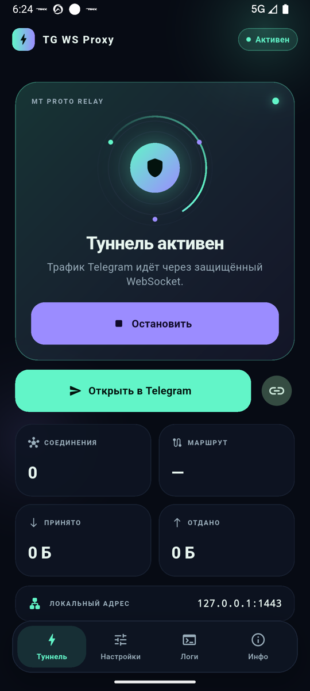
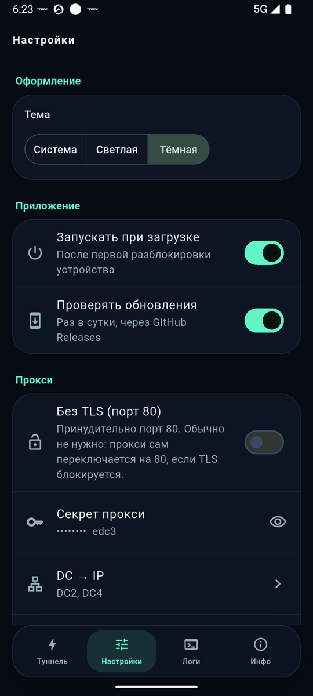
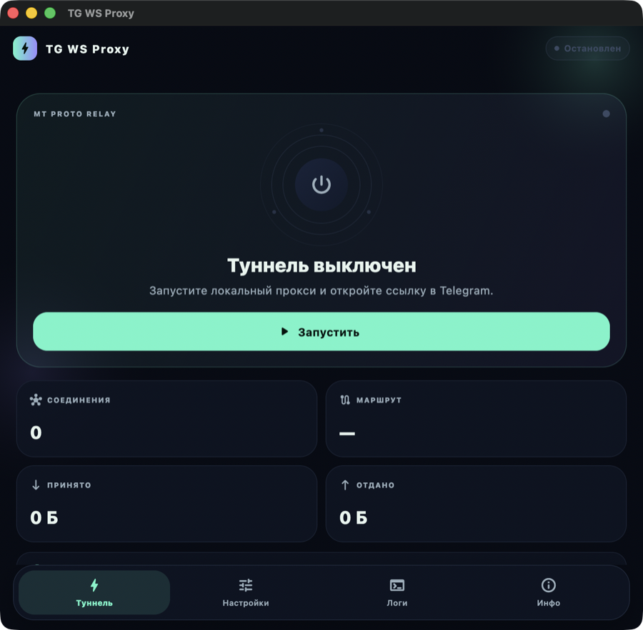
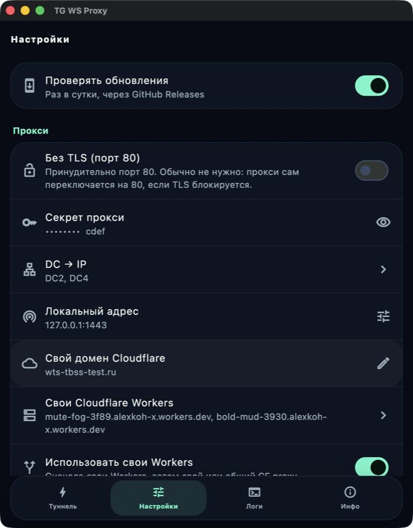

# TG WS Proxy

Локальный MTProto-прокси для Telegram: Telegram → `127.0.0.1:1443` → WebSocket через Cloudflare Worker или собственный домен → DC. Прямой TCP используется как fallback.

- **Android** — Flutter UI + чисто Dart-ядро `tg_proxy_core`, foreground service.
- **iOS** — тот же Flutter UI + Network Extension с Rust-ядром (GPLv3), работает в фоне без CoreLocation.
- **macOS и Windows** — тот же Flutter UI + Dart-ядро в процессе приложения, иконка в menu bar / трее.

Приложение переосмысляет рабочий [AndMTProto](https://github.com/oruviyex18/AndMTProto). Архитектура и этапы — в [docs/architecture.md](docs/architecture.md).

## Скриншоты

<table align="center">
  <tr>
    <th></th>
    <th>Туннель</th>
    <th>Настройки</th>
  </tr>
  <tr>
    <th>Android</th>
    <td valign="top"></td>
    <td valign="top"></td>
  </tr>
  <tr>
    <th>macOS</th>
    <td valign="top"></td>
    <td valign="top"></td>
  </tr>
</table>

## Статус

Android-версия собрана и проверена на реальном устройстве: прокси, foreground service, QS tile, автозапуск, настройки DC/секрета/Cloudflare, логи. Android APK публикуется в [Releases](https://github.com/waslost0/tgwsproxy/releases).

iOS-версия собирается локально из исходников и **не входит в GitHub Releases**: для Network Extension нужна платная учётная запись Apple Developer и подпись своим сертификатом. Инструкция — ниже.

macOS-версия собирается локально и использует то же Dart-ядро в процессе приложения; подпись и нотаризация не требуются для запуска на своём Mac. Инструкция — ниже.

Windows-версия собирается локально из `windows/` и также запускает Dart-ядро в процессе приложения. Работает из трея, поддерживает автозапуск при входе и не требует установки драйверов или служб. Инструкция — ниже.

## Стек

- Flutter 3.50 / Dart 3.14
- MVVM + `provider` + `go_router`
- `drift` для локального UI-состояния
- `packages/tg_proxy_core` — чистое Dart-ядро (порт MIT Python-кода Flowseal)
- Android: minSdk 29, targetSdk 36, compileSdk 37
- iOS: Network Extension (packet tunnel) + Rust-ядро, iOS 15+
- macOS: Flutter + Dart-ядро в процессе, macOS 12+
- Windows: Flutter + Dart-ядро в процессе, Windows 10/11 x64
- Сборка iOS: Xcode 26+, Flutter 3.50, Rust с target `aarch64-apple-ios`
- Платная учётная запись Apple Developer с доступом к Network Extensions

## Быстрый старт

```bash
flutter pub get
dart run build_runner build
flutter run
```

Тесты:

```bash
flutter test
dart test packages/tg_proxy_core
```

Сборка Android:

```bash
flutter build apk --debug
```

Сборка Windows:

```bash
flutter build windows --release
```

## Релиз

Пуш тега запускает GitHub Actions. Он собирает Android APK, macOS `.zip` и Windows x64 `.zip` на родных раннерах и прикладывает все файлы к одному GitHub Release.

```bash
git tag -a v0.5.2 -m "TG WS Proxy 0.5.2"
git push origin v0.5.2
```

Тег должен совпадать с версией в `pubspec.yaml`. Android подписывается release-ключом из секретов репозитория (`ANDROID_KEYSTORE_BASE64`, `ANDROID_KEYSTORE_PASSWORD`, `ANDROID_KEY_ALIAS`, `ANDROID_KEY_PASSWORD`); macOS и Windows артефакты не подписаны. Если нужно пересобрать существующий тег, запустите workflow **Release** вручную и укажите тег.

## iOS

iOS-сборка не публикуется в Releases: приложение использует **Network Extension**, поэтому подписывать его нужно своей платной учётной записью Apple Developer. Бесплатный Apple ID не поддерживает capability `Network Extensions`.

### Что понадобится

- macOS с Xcode 26+ и установленными command line tools;
- Flutter 3.50+;
- платная учётная запись Apple Developer;
- iPhone с iOS 15+;
- для пересборки Rust-ядра — Rust и target `aarch64-apple-ios`;
- свой домен Cloudflare или Worker, если провайдер блокирует встроенные домены.

Готовая `ios/RustCore/libtgwsproxy.a` уже лежит в репозитории, поэтому Rust нужен только если меняешь `ios/RustCore/src`.

### Подпись в Xcode

1. Открой `ios/Runner.xcworkspace`.
2. Выбери проект `Runner` → target `Runner` → **Signing & Capabilities**: укажи свою Team и уникальный Bundle Identifier.
3. Повтори то же для target `TgwsTunnel`: своя Team и Bundle Identifier вида `<bundle>.tunnel`.
4. Включи для обоих targets capability **Network Extensions** (`Packet Tunnel`) и **App Groups** с одинаковой группой.
5. Если меняешь bundle id, обнови его также в `ios/Runner/TunnelManager.swift` (`providerBundleIdentifier`) и имя App Group в `TunnelManager.swift`, `PacketTunnelProvider.swift`, `NativeProxy.swift` и обоих `.entitlements`.
6. Оба provisioning profile должны содержать `packet-tunnel-provider` и App Group. Xcode создаёт их автоматически при включённой автоматической подписи.

### Сборка

```bash
flutter pub get
flutter build ios --release
```

Если пересобираешь Rust-ядро:

```bash
rustup target add aarch64-apple-ios
PLATFORM_NAME=iphoneos ARCHS=arm64 CURRENT_ARCH=arm64 \
  SDKROOT="$(xcrun --sdk iphoneos --show-sdk-path)" \
  sh ios/scripts/build-rust-ios.sh
cp ios/.build/rust/libtgwsproxy.a ios/RustCore/libtgwsproxy.a
flutter build ios --release
```

`ios/scripts/resign.sh` нужен только при ошибке `code signature` после `flutter build ios --release`: он переподписывает вложенные framework, расширение и приложение с entitlements из provisioning profiles. По умолчанию скрипт настроен на team `2XZ277USL9` и сертификат Mark Koh; для другой команды задай `TGWS_TEAM` и `TGWS_IDENTITY` и обнови bundle id в скрипте.

### Установка на iPhone

```bash
xcrun devicectl list devices
bash ios/scripts/resign.sh
xcrun devicectl device install app --device <UDID> build/ios/iphoneos/Runner.app
xcrun devicectl device process launch --device <UDID> com.whitetigersoft.tgwsproxy
```

Либо открой `ios/Runner.xcworkspace`, выбери iPhone и нажми Run.

### Первый запуск

1. Открой приложение и нажми запуск туннеля.
2. Разреши iOS добавить VPN-конфигурацию.
3. Скопируй ссылку `tg://proxy?...` и нажми **Открыть в Telegram**.
4. Либо добавь вручную: Telegram → Настройки → Данные и память → Прокси → Добавить прокси → MTProto, сервер `127.0.0.1`, порт `1443`, секрет из приложения.
5. Network Extension работает в фоне без CoreLocation; индикатор VPN должен оставаться включённым.

### AltStore и TestFlight

- **AltStore** не подходит для бесплатного Apple ID: он не даёт entitlement Network Extension. С платным сертификатом возможны проблемы с переподписью вложенного `.appex`.
- **TestFlight** технически возможен с платным аккаунтом, но требует App Store Connect и загрузки сборки; для личного использования проще Xcode/devicectl.
- Готового IPA в Releases нет.

## macOS

macOS-приложение использует общий Flutter UI и чистое Dart-ядро `tg_proxy_core` в процессе приложения — без Network Extension и платного аккаунта.

```bash
flutter pub get
flutter build macos --release
open "build/macos/Build/Products/Release/TG WS Proxy.app"
```

- Прокси слушает `127.0.0.1:1443`; ссылка и настройки — как на Android.
- Cloudflare сначала пробуется по TLS (443). Если провайдер блокирует рукопожатие, прокси сам переключается на порт 80 и периодически проверяет TLS снова. «Без TLS (порт 80)» принудительно оставляет только порт 80.
- Если Telegram показывает `connecting...`, удали старую запись `127.0.0.1:1443` и добавь заново через «Открыть в Telegram» — секрет у нового macOS-билда свой.
- Настройки и секрет лежат в `~/Library/Containers/com.whitetigersoft.tgwsproxy/Data/Library/Application Support/com.whitetigersoft.tgwsproxy/proxy_settings.json`. Секрет не хранится в Keychain.
- Закрытие окна не завершает приложение; клик по иконке в Dock открывает его снова.
- В menu bar есть иконка со статусом и меню: «Подключить/Отключить», «Открыть Telegram», «Скопировать ссылку», «Открыть приложение», «Выход».
- Автозапуск при входе не поддерживается. Bot API работает через свой Cloudflare Worker.
- Для распространения вне своего Mac нужна подпись Developer ID и нотаризация; в релизах лежит неподписанная сборка.

## Windows

Windows-приложение использует общий Flutter UI и чистое Dart-ядро `tg_proxy_core` в процессе приложения — без служб, драйверов и WFP.

```powershell
flutter pub get
flutter build windows --release
.\build\windows\x64\runner\Release\tgwsproxy.exe
```

- Прокси слушает `127.0.0.1:1443`; ссылка и настройки — как на Android и macOS.
- Cloudflare сначала пробуется по TLS (443). Если провайдер блокирует рукопожатие, прокси сам переключается на порт 80 и периодически проверяет TLS снова.
- Свой домен Cloudflare и свои Workers задаются в настройках. Домен используется как `kws<DC>.<домен>`; Workers включаются отдельным переключателем. Настройки из iOS-экспорта (`domain`, `cfUserDomains`, `cfWorkerDomains`) импортируются без потерь.
- Настройки и секрет лежат в `%APPDATA%\TG WS Proxy\proxy_settings.json`. Секрет не хранится в Credential Manager.
- Закрытие окна сворачивает приложение в трей и не останавливает прокси. Двойной клик по иконке возвращает окно, меню трея содержит «Подключить/Отключить», «Открыть Telegram», «Скопировать ссылку», «Открыть приложение» и «Выход». Повторный запуск `tgwsproxy.exe` открывает уже работающее окно вместо второго экземпляра.
- Обновление: «О приложении» → «Проверить обновление». На Windows приложение само скачивает zip, проверяет SHA-256, заменяет файлы и перезапускается; настройки и секрет сохраняются. Нужна папка, доступная на запись (не `Program Files`). Первую версию с поддержкой автообновления (`0.6.0`) нужно поставить вручную; дальше обновления идут из приложения.
- Автозапуск при входе включается переключателем в настройках и пишет запись в `HKCU\Software\Microsoft\Windows\CurrentVersion\Run` с аргументом `--autostart`.
- Для распространения нужна подпись кода; в релизах лежит неподписанная сборка.

## Маршрут Cloudflare

Встроенные домены `cfproxy` из upstream больше не отвечают (`404` после
WebSocket-upgrade). Для работы на сетях с DPI нужен собственный Cloudflare:

1. Разверните Worker по [CfWorker.md](https://github.com/Flowseal/tg-ws-proxy/blob/main/CfWorker.md)
   и добавьте один или несколько адресов `*.workers.dev` в настройках приложения.
2. Либо укажите свой домен из [CfProxy.md](https://github.com/Flowseal/tg-ws-proxy/blob/main/CfProxy.md):
   A-записи `kws1`…`kws5` и `kws203` на IP дата-центров Telegram, прокси включён.
3. Свои Workers используются первыми, затем свой домен, затем общий список CF.

TLS и порт 80 переключаются автоматически: сначала пробуется 443, при блокировке
рукопожатия — 80, с фоновой проверкой TLS. Включайте «Без TLS (порт 80)», только
если нужно принудительно оставить HTTP. Трафик Telegram остаётся зашифрованным
end-to-end.

## Структура

```
lib/
  core/        application, model, router, theme, db
  features/    connection, settings, logs, info
  proxy_main.dart  headless entrypoint (stage 5)
packages/
  tg_proxy_core/   pure Dart engine (relay, transports, FakeTLS, Bot API)
docs/
  architecture.md  architecture and contracts
  code-map.md      per-file responsibilities
```

## Лицензия

Android-, macOS- и Windows-части и Dart-ядро — MIT. См. [LICENSE](LICENSE) и [NOTICE](NOTICE). Проект основан на MIT-коде Flowseal.

iOS Network Extension содержит Rust-ядро под GPLv3; текст лицензии — `ios/RustCore/COPYING`. Если распространяешь iOS-сборку, учитывай требования GPLv3 к исходному коду.
